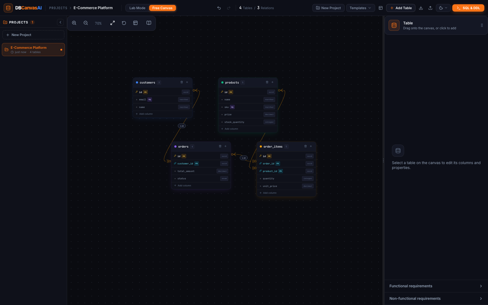

# DBCanvasAI - Visual Database Schema Designer

Live App: https://java4rohit.github.io/DBCanvasAI/
Repo: https://github.com/java4rohit/DBCanvasAI



---

## Features

- Visual Canvas: Drag and drop tables on an infinite interactive canvas
- Relation Lines: Draw 1:1, 1:N, N:M relationships visually with FK support
- Themes: Dark / Night / Light theme switcher
- SQL Export: PostgreSQL, MySQL, SQLite
- Export Formats: Prisma schema, DBML, and Mermaid ER diagrams
- Undo / Redo: Full history with Ctrl+Z / Ctrl+Y
- JSON Import / Export: Save and load schema as JSON
- Lab Mode: Guided step-by-step schema design challenges
- Resizable Panels: Drag to resize left and right panels
- Requirements Panel: Add functional and non-functional requirements
- Auto Arrange: Auto-layout all tables on canvas
- Full Column Types: UUID, BIGSERIAL, VARCHAR, JSONB, ENUM, ARRAY, BYTEA and more

---

## Getting Started

```bash
git clone https://github.com/java4rohit/DBCanvasAI.git
cd DBCanvasAI
npm install
npm run dev
```

Open http://localhost:5173 in your browser.

```bash
npm run build    # production build
npm run preview  # preview locally
```

---

## Project Structure

```
DBCanvasAI/
+-- public/              Static assets
+-- src/
|   +-- components/
|   |   +-- Canvas/      Infinite canvas + table cards + relation SVG lines
|   |   +-- Modals/      Add and Edit table modals
|   |   +-- Navigation/  Top navbar
|   |   +-- RightPanel/  Column editor and requirements panel
|   |   +-- SQLGenerator/ SQL output panel with dialect switcher
|   |   +-- Lab/         Guided lab sidebar with step validation
|   |   +-- NewProject/  New project start screen
|   +-- context/         ThemeContext - Dark/Night/Light
|   +-- data/            templates.ts, lmsLabSteps.ts
|   +-- hooks/           useHistory.ts - undo/redo
|   +-- types/           schema.ts - ALL TypeScript types
|   +-- utils/           sqlGenerator.ts - SQL/Prisma/DBML/Mermaid
|   +-- App.tsx          Root - all global state lives here
|   +-- main.tsx         Entry point
+-- .github/workflows/deploy.yml  Auto-deploy on push to main
+-- vite.config.ts               Vite config (base: /DBCanvasAI/)
```

---

## Tech Stack

| Tool | Purpose |
|---|---|
| React 19 | UI framework |
| TypeScript 7 | Type safety |
| Vite 6 | Build tool and dev server |
| Lucide React | Icons |
| Canvas Confetti | Lab mode celebration animations |
| GitHub Pages | Free production hosting |
| GitHub Actions | Auto CI/CD deployment pipeline |


---

## Next Development Phase - Roadmap

### Phase 2 - High Priority

#### 1. Local Storage Auto-Save
Where: src/App.tsx - useEffect watching tables, relations, projectName

```ts
useEffect(() => {
  localStorage.setItem('DBCanvasAIAI_schema', JSON.stringify({ tables, relations, projectName }));
}, [tables, relations, projectName]);
const saved = localStorage.getItem('DBCanvasAIAI_schema');
if (saved) { const p = JSON.parse(saved); /* setTables/setRelations */ }
```

#### 2. Multiple Projects Support
Where: src/context/ProjectContext.tsx + src/components/ProjectManager/
Note: ProjectMeta interface already exists in src/types/schema.ts

#### 3. Search and Filter Tables
Where: src/components/Navigation/Navbar.tsx - add search input
Tip: Filter tables array and pan canvas viewport to the match

#### 4. Export Canvas as PNG
Install: npm install html-to-image
Where: src/components/Navigation/Navbar.tsx - add export button
Usage: import { toPng } from 'html-to-image'; toPng(canvasRef.current)

#### 5. Column CHECK Constraints
Where: src/components/RightPanel/ColumnEditor.tsx
Type: Add checkConstraint?: string to Column in src/types/schema.ts

---

### Phase 3 - Medium Priority

#### 6. Share Schema via URL
Install: npm install lz-string
Where: src/utils/shareUtils.ts - encodeSchema() and decodeSchema()
URL format: https://java4rohit.github.io/DBCanvasAI/?schema=<base64>

#### 7. Import SQL DDL to Canvas
Where: src/utils/sqlParser.ts + src/components/Modals/ImportSQLModal.tsx
Approach: Regex parse CREATE TABLE - extract columns, types, PKs, FKs

#### 8. Schema Statistics Panel
Where: Add stats section to src/components/RightPanel/RightPanel.tsx

#### 9. Table Groups and Canvas Regions
Where: Create src/components/Canvas/TableGroup.tsx
Type: Add groupId?: string to Table in src/types/schema.ts

#### 10. Custom Table Color Picker
Where: src/components/RightPanel/TableHeader.tsx
Type: Change TableColor from union to string in src/types/schema.ts

---

### Phase 4 - Advanced and Future

#### 11. AI Schema Generator
Tech: OpenAI API or Google Gemini API (both free tiers available)
Where: src/components/Modals/AIGenerateModal.tsx
Approach: API returns JSON matching Table[] and Relation[] types

#### 12. Real-time Collaboration
Tech: Liveblocks (https://liveblocks.io) or PartyKit (https://partykit.io)
Where: Wrap App.tsx state with Liveblocks useStorage and useMutation

#### 13. Import from Live Database
Tech: Supabase Edge Functions (free tier)
Where: src/components/Modals/ConnectDBModal.tsx

#### 14. Mobile and Touch Support
Where: src/components/Canvas/Canvas.tsx - add touch event handlers
Tip: e.touches[0] for drag, distance between e.touches[0] and [1] for zoom

#### 15. More Lab Templates
Where: src/data/lmsLabSteps.ts - duplicate and fill the LabStep pattern
Reference: LabStep interface in src/types/schema.ts

---

## How to Add a New Feature

1. Branch: git checkout -b feature/your-feature-name
2. Conventions:
   - Types go in src/types/schema.ts
   - Global state in src/App.tsx
   - Utility/SQL logic in src/utils/
   - Components in src/components/FeatureName/
3. Build first: npm run build
4. Push and open Pull Request - auto-deploys on merge to main.

---

## Deployment

Every push to main triggers .github/workflows/deploy.yml
Steps: install > build > deploy to GitHub Pages (~2 minutes)
Status: https://github.com/java4rohit/DBCanvasAI/actions
Live: https://java4rohit.github.io/DBCanvasAI/

---

## Built by

Rohit Yadav - https://github.com/java4rohit

---

## License

MIT - free to use, modify and distribute.
